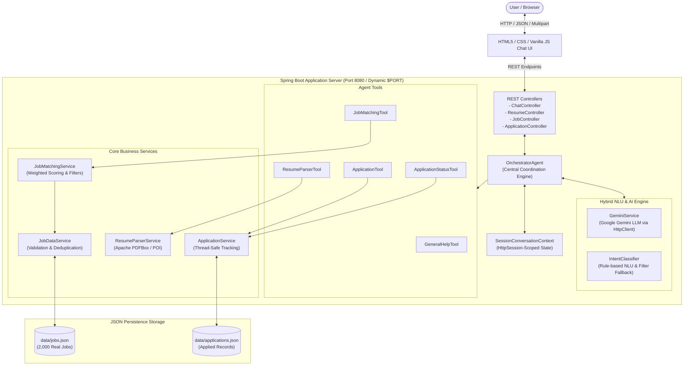

# HireMate AI — Autonomous AI Job Search & Application Agent

**HireMate AI** is an intelligent, conversational career assistant designed for the **SDE Intern – AI Agents & Automation** assessment project for **Hidani Tech**. 

It provides an end-to-end workflow: from parsing PDF/DOCX resumes, to evaluating real-world listings using transparent weighted matching, to interactive conversational filtering, and tracking local job applications through a multi-turn autonomous agent architecture.

---

## Tech Stack & Architecture Highlights

- **Backend**: Java 21, Spring Boot 3.2.5, Apache Maven
- **Resume Extraction**: Apache PDFBox 3.0.2 (PDF text extraction), Apache POI 5.2.5 (DOCX extraction)
- **Data Persistence**: Thread-safe JSON file storage (`data/jobs.json`, `data/applications.json`)
- **Frontend**: Clean, responsive single-page chat interface written in HTML5, CSS3, and Vanilla JavaScript (No React, Node.js, or external JS build tools required)
- **Architecture**: Modular Tool-based Agent pattern (`OrchestratorAgent`) with session-isolated conversation context (`SessionConversationContext`).
- **AI & LLM Integration**: Google Gemini LLM API integration (`GeminiService`) via native Java 21 `HttpClient`, featuring automatic graceful fallback to a deterministic rule-based NLU engine (`IntentClassifier`) when no key is set or offline.
- **Security & Portability**: Zero hardcoded credentials. Dynamic cloud port resolution (`${PORT:8080}`) for seamless Docker deployment on Render, Railway, or AWS.

---

## Prerequisites

Before running the application, ensure the following are installed and configured on your system:

- **Java Development Kit (JDK)**: **Java 21** or higher (`java -version`)
- **Apache Maven**: **3.9+** (`mvn -version`)
- **Web Browser**: Modern browser (Chrome, Edge, Firefox, Safari)

---

## Quick Start & Running Locally

### 1. Build and Run the Spring Boot Application

Open a terminal in the root project directory:

```bash
# Clean build and compile
mvn clean package -DskipTests

# Run the Spring Boot application
mvn spring-boot:run
```

Once started, the application serves both backend APIs and the frontend on port **8080**:
- **Chat Web Interface**: [http://localhost:8080](http://localhost:8080)
- **Health Check Endpoint**: [http://localhost:8080/api/health](http://localhost:8080/api/health)
- **Job Listings API**: [http://localhost:8080/api/jobs](http://localhost:8080/api/jobs)

---

## Core Features & System Capabilities

### Resume Upload & Parsing
- **Endpoint**: `POST /api/resume/parse` (accepts `multipart/form-data`)
- **Supported Formats**: `.pdf` (via Apache PDFBox) and `.docx` (via Apache POI).
- **Validation**: Enforces 5 MB upload limits, rejects empty files, detects encrypted or scanned documents, and handles corrupted files without crashing the server.
- **Extracted Fields**:
  - Full Name
  - Email & Phone Number
  - Target Designation / Role
  - Technical Skills (normalized against an industry dictionary)
  - Work Experience & Internships
  - Education & Degrees
  - Academic & Personal Projects
- **Privacy & Session Isolation**: Parsed profiles are stored strictly within the user's `HttpSession` state. Different browser sessions never share candidate data.

### Real Job Dataset Collection
- **Storage**: `data/jobs.json`
- **Permitted Public APIs**:
  1. **Arbeitnow Public Job Board API**: Free official public job board API (`https://www.arbeitnow.com/api/job-board-api`) returning real tech positions with genuine URLs.
  2. **Remotive Public Tech API**: Official developer job API (`https://remotive.com/api/remote-jobs`).
- **Ingestion Characteristics**:
  - Fully resumable: verifies against existing job IDs and canonical source links before appending.
  - Strips HTML formatting, detects experience level requirements, and catalogs required skill tags.
  - Does **not** fabricate fake jobs or companies.
- **Run the Collector Separately**:
  ```bash
  # Execute the standalone ingestion utility (Target: 2,000 real jobs)
  mvn compile exec:java "-Dexec.mainClass=com.hidani.hiremate.ingestion.JobCollector"
  ```
- **Job REST Endpoints**:
  - `GET /api/jobs?page=0&size=10` — Paginated job listings
  - `GET /api/jobs/{jobId}` — Retrieve specific job details
  - `GET /api/jobs/count` — Total verified listings loaded

### Transparent Weighted Job Matching
- **Algorithm**:
  - **Skill Overlap (50% weight)**: Normalized alias matching (e.g., `ReactJS` $\rightarrow$ `React`, `SpringBoot` $\rightarrow$ `Spring Boot`, `K8s` $\rightarrow$ `Kubernetes`).
  - **Title Similarity (30% weight)**: Token overlap between candidate target role and job title.
  - **Experience Alignment (10% weight)**: Compares detected years of experience vs required years. Identifies explicit mismatches (e.g., senior roles requiring 5+ years matched against an entry-level resume).
  - **Remote / Format Fit (10% weight)**: Remote availability alignment.
- **Conversational Filters**:
  - Remote only: *"Show only remote jobs"*
  - Specific skills: *"Show jobs requiring React and TypeScript"*
  - Employment type: *"Find Java internships"*
  - Match threshold: *"Show jobs with at least 70% match"*
  - Location: *"Find roles in Bengaluru"*
  - Reset: *"Clear filters"*

### Autonomous Agent Architecture & Dataflow

HireMate employs a lightweight, decoupled agent architecture with a hybrid LLM + Rule-Based NLU engine:



#### End-to-End Dataflow:
1. **Resume Ingestion**: The user uploads a PDF or DOCX file via `POST /api/resume/parse`. `ResumeParserService` extracts raw text via Apache PDFBox/POI, extracts candidate fields (name, email, skills, experience, education, projects) using regex and normalized dictionaries, and saves the profile in `SessionConversationContext`.
2. **Hybrid Intent Classification & Reasoning**: When the user posts a message to `POST /api/chat`, `OrchestratorAgent` first checks if `GeminiService` is available (`GEMINI_API_KEY`). If available, Gemini performs contextual intent classification and extracts structured filters (remote, role keywords, skills, match percentage). If the key is not set or network fails, it immediately and seamlessly falls back to the deterministic `IntentClassifier`.
3. **Job Matching & Filtering**: `JobMatchingTool` pulls the candidate's active profile and filters from `SessionConversationContext`, queries `JobDataService` (which has loaded and deduplicated 2,000 verified listings from `data/jobs.json`), computes transparent weighted scores, and saves the 1-based indexed results back into the session context.
4. **Interactive Application & Confirmation**: When the user says *"Apply to job 2"*, `ApplicationTool` resolves the 2nd listing from the session context, verifies the company/title, and creates a pending confirmation. Once confirmed (*"Yes, apply"*), `ApplicationService` records the application thread-safely in `data/applications.json`.
5. **Session Isolation**: All user states (resumes, recommendation lists, active filters, pending confirmations) are scoped strictly per browser session using `HttpSession`, ensuring multi-user privacy without requiring accounts or logins.

---

### Google Gemini LLM API Configuration

HireMate AI includes a native, secure Google Gemini integration using Java 21's `HttpClient`:

- **Environment Variable**: `GEMINI_API_KEY`
- **Model Used**: `gemini-3.8-flash` (or configured via `GEMINI_MODEL`)
- **Key Security**: Keys are read strictly from system environment variables or `application.properties`. Keys are **never** logged, exposed to the frontend, or committed to source control.
- **Graceful Fallback**: If `GEMINI_API_KEY` is not provided, the application runs with 100% functionality using the built-in deterministic NLU engine.

#### To Run with Gemini Enabled:
```bash
# On Linux / macOS / Render:
export GEMINI_API_KEY="your-google-gemini-api-key"
mvn spring-boot:run

# On Windows PowerShell:
$env:GEMINI_API_KEY="your-google-gemini-api-key"
mvn spring-boot:run
```

---

### 5. Application Tracking & Confirmation
- **Storage**: Thread-safely stored in `data/applications.json` using `ReentrantLock`.
- **Confirmation Safety**: When a user asks to apply (e.g., *"Apply to job 1"*), the agent identifies the role and employer, prompting:
  > *"You selected **[Job Title]** at **[Company]**. Would you like me to record this application? (Reply 'Yes, apply' to confirm or 'Cancel' to decline)."*
- **Duplicate Prevention**: Prevents duplicate applications to the same job within the same user session.
- **Honest Tracking Disclaimer**: Applications are tracked locally within HireMate AI to assist candidate organization, with direct links provided to original employer career portals.

---

### 6. APIs Used

#### Internal REST Endpoints:
- `GET /api/health` — System status and version response
- `POST /api/chat` — Conversational interface accepting JSON or Multipart (with attachments)
- `POST /api/chat/reset` — Resets session context for a fresh chat
- `POST /api/resume/parse` — Uploads and parses PDF/DOCX resumes
- `GET /api/resume/current` — Retrieves active session profile
- `GET /api/jobs` — Paginated job listings (`?page=0&size=10`)
- `GET /api/jobs/{jobId}` — Retrieves a single job by ID
- `GET /api/jobs/count` — Returns total verified listings loaded
- `POST /api/jobs/match` — Matches jobs against session profile and filters
- `POST /api/applications` — Records a new job application
- `GET /api/applications` — Lists all applications in current session
- `GET /api/applications/{applicationId}` — Status of a specific application

#### External Public APIs:
- **Arbeitnow Public Job API**: `https://www.arbeitnow.com/api/job-board-api` (Official free job board API used to gather 2,000 real software engineering listings with authentic source links).
- **Remotive Public Tech API**: `https://remotive.com/api/remote-jobs` (Integrated as secondary permitted public tech job source).

---

### Cloud Deployment Guide (Live Deployed Link)

To get a **live deployed link** as requested in the submission guidelines, you can deploy using any free cloud provider in minutes:

#### Deploy to Render (Recommended)
1. Push your repository to your GitHub account:
   ```bash
   git init
   git add .
   git commit -m "Complete HireMate AI autonomous agent"
   git remote add origin https://github.com/ast-haaa/-AI-job-chat-assistant.git
   git push -u origin main
   ```
2. Log in to [render.com](https://render.com) and click **New + > Web Service**.
3. Connect your GitHub repository.
4. Set the following configuration:
   - **Environment**: `Docker`
   - **Plan**: `Free`
   - **Environment Variables** (Optional):
     - `GEMINI_API_KEY`: `your-google-gemini-api-key` (Enables dynamic LLM reasoning)
5. Click **Create Web Service**. 
   - Render builds the provided `Dockerfile` and dynamically injects its assigned `$PORT`.
   - The application automatically binds to `${PORT:8080}` without configuration conflicts.
   - You receive a public HTTPS live URL (e.g., `https://hiremate-ai.onrender.com`).

#### Deploy to Railway
1. Log in to [railway.app](https://railway.app).
2. Choose **Deploy from GitHub repo**.
3. Under Variables, optionally add `GEMINI_API_KEY`.
4. Railway detects the `Dockerfile` and deploys automatically.
5. In **Settings > Networking**, click **Generate Domain** to get your public live URL.

#### Local Tunnel for Instant Demo Link
```bash
# Using localtunnel for instant external access to local port 8080
npx localtunnel --port 8080
```

---

### Recommended 3–5 Minute Screen Recording Demo Flow

Follow this flow for the screen recording required by the Hidani Tech submission guidelines:

1. **System Introduction (0:00 - 0:45)**:
   - Open [http://localhost:8080](http://localhost:8080) (or live link).
   - Point out the clean UI, the active 2,000 real job counter loaded from `data/jobs.json`, and explain the multi-turn agent architecture.
2. **Resume Upload & Autonomous Parsing (0:45 - 1:45)**:
   - Drag and drop (or attach) a sample PDF or DOCX resume.
   - Show how the agent parses contact info, detected skills, experience, and education without fabricating missing data.
   - Point out the active status indicator updating in the sidebar.
3. **Conversational Job Matching (1:45 - 2:45)**:
   - Prompt: *"Find jobs matching my resume"*.
   - Review the transparent matching score breakdown: skill overlap, title fit, and experience explanation.
   - Show natural conversational filters: *"Show only remote roles"* or *"Find jobs requiring React"*.
4. **Application Selection & Interactive Confirmation (2:45 - 3:45)**:
   - Prompt: *"Apply to job 1"*.
   - Show the interactive confirmation prompt: *"Would you like me to record this application?"*.
   - Click or type *"Yes, apply"*.
   - Highlight the transparency notice: the application is recorded thread-safely in `data/applications.json`, with the original posting link available for external employer submission.
5. **Application Status Tracking (3:45 - 4:15)**:
   - Prompt: *"Show my applied jobs"*.
   - View the recorded application history with timestamps and status.
   - Prompt: *"Have I applied to [Company]?"* to demonstrate memory and contextual status lookups.

---

## Example Conversations

| User Prompt | Agent Action |
|---|---|
| *"Hi, what can you do?"* | Explains resume upload, job matching, and application tracking capabilities. |
| *(Uploads resume.pdf)* | Parses resume, extracts skills & experience, displays profile card in chat. |
| *"Find jobs matching my resume"* | Runs weighted matching algorithm, returns top job cards with match % and explanations. |
| *"Show only remote jobs"* | Refines current search preserving resume context, showing only remote positions. |
| *"Apply to job 2"* | Resolves second recommendation, asks user for confirmation before recording. |
| *"Yes, apply"* | Validates job, checks duplicates, saves record to `data/applications.json`, confirms status. |
| *"Show my applied jobs"* | Displays list of all applications submitted in this session. |

---

## Running the Automated Test Suite

The test suite covers:
- Resume parsing (PDF, DOCX, empty files, corrupted docs, missing fields)
- Job loading, deduplication, invalid IDs, pagination
- Matching algorithms, skill normalization, experience mismatch detection
- Intent classification, conversation context, 1-based job indexing
- Application concurrency, duplicate prevention, session isolation

```bash
mvn test
```

---

## Project Structure

```
├── pom.xml
├── README.md
├── .gitignore
├── data/
│   ├── jobs.json             # Real job listings dataset
│   └── applications.json     # Saved application records
└── src/
    ├── main/
    │   ├── java/com/hidani/hiremate/
    │   │   ├── HireMateApplication.java
    │   │   ├── agent/
    │   │   │   ├── Intent.java
    │   │   │   ├── IntentClassifier.java
    │   │   │   ├── OrchestratorAgent.java
    │   │   │   └── tool/
    │   │   │       ├── AgentTool.java
    │   │   │       ├── ApplicationStatusTool.java
    │   │   │       ├── ApplicationTool.java
    │   │   │       ├── GeneralHelpTool.java
    │   │   │       ├── JobMatchingTool.java
    │   │   │       ├── ResumeParserTool.java
    │   │   │       ├── ToolContext.java
    │   │   │       └── ToolResult.java
    │   │   ├── controller/
    │   │   │   ├── ApplicationController.java
    │   │   │   ├── ChatController.java
    │   │   │   ├── HealthController.java
    │   │   │   ├── JobController.java
    │   │   │   └── ResumeController.java
    │   │   ├── ingestion/
    │   │   │   └── JobCollector.java
    │   │   ├── model/
    │   │   │   ├── Application.java
    │   │   │   ├── ApplicationRequest.java
    │   │   │   ├── ChatRequest.java
    │   │   │   ├── ChatResponse.java
    │   │   │   ├── HealthResponse.java
    │   │   │   ├── Job.java
    │   │   │   ├── JobMatchFilter.java
    │   │   │   ├── JobMatchResult.java
    │   │   │   ├── JobPageResponse.java
    │   │   │   ├── ResumeProfile.java
    │   │   │   └── SessionConversationContext.java
    │   │   └── service/
    │   │       ├── ApplicationService.java
    │   │       ├── JobDataService.java
    │   │       ├── JobMatchingService.java
    │   │       └── ResumeParserService.java
    │   └── resources/
    │       ├── application.properties
    │       └── static/
    │           ├── index.html
    │           ├── css/style.css
    │           └── js/app.js
    └── test/
        └── java/com/hidani/hiremate/
            ├── agent/OrchestratorAgentTest.java
            ├── controller/HealthControllerTest.java
            └── service/
                ├── ApplicationServiceTest.java
                ├── JobDataServiceTest.java
                ├── JobMatchingServiceTest.java
                └── ResumeParserServiceTest.java
```

---

## License & Notes
Developed for the Hidani Tech SDE Intern AI Agents & Automation Assessment. All external job source terms and rate limits are respected during ingestion.

